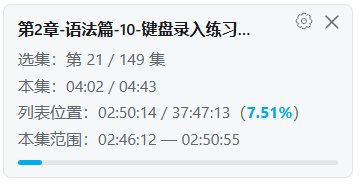
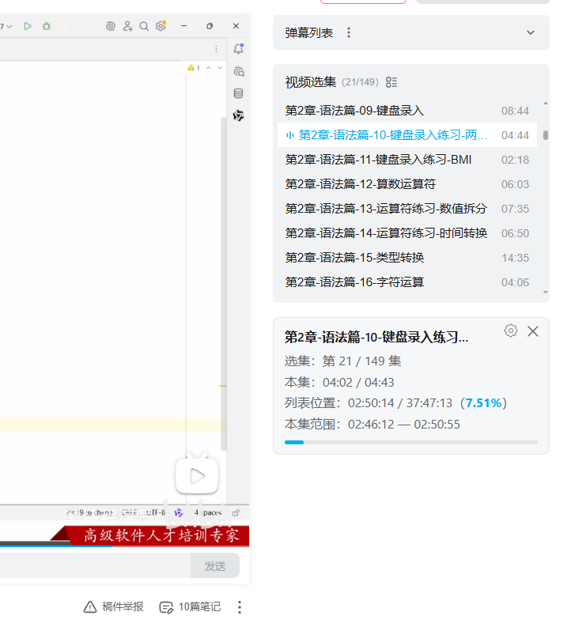
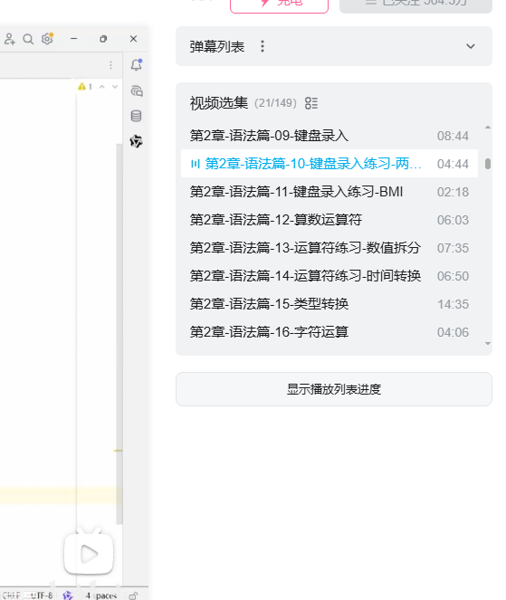

# B站合集进度助手

Bilibili Playlist Progress Assistant

版本变更见 [更新日志](./CHANGELOG.md)。

一个用于 B 站视频页面的油猴脚本：读取右侧选集的时长，展示当前视频在整个列表总时长中的位置。

## 功能

- 展示当前集数、总集数、本集播放时间与时长。
- 展示列表累计时间、总时长、百分比及进度条。
- 展示本集在整个列表中的时间范围。
- 多集视频默认展开；没有选集或只有一集时默认收起。
- 支持通过叉号收起，再点击“显示播放列表进度”恢复。
- 有选集时，面板放在 `.rcmd-tab` 容器内部、`.video-pod` 之后；无选集时放在右栏容器内、`.rcmd-tab` 之前，避免影响 B 站组件初始化。容器尚未加载时使用右栏作为备用位置。
- 全屏时隐藏，退出全屏后根据当前展开状态恢复显示。
- 默认每 5 秒刷新播放进度，拖动进度条完成后立即更新。
- 叉号旁的“设置”按钮可切换到设置页，选择关闭、5 秒、10 秒、30 秒或 1 分钟刷新；修改后立即生效并在本机记忆。

## 安装

1. 在浏览器中安装 Tampermonkey（油猴）。
2. 打开 Tampermonkey 管理面板，选择“添加新脚本”。
3. 将 [bilibili-playlist-progress-assistant.js](./bilibili-playlist-progress-assistant.js) 的完整内容复制到编辑器中，替换默认内容并保存。
4. 打开或刷新 `https://www.bilibili.com/video/` 下的视频页面。

## 使用说明

面板示例：

```text
当前视频标题
选集：第 3 / 10 集
本集：02:00 / 10:00
列表位置：22:00 / 01:40:00（22.00%）
本集范围：20:00 — 30:00
```

“列表位置”按前面各集时长之和加上当前视频播放时间计算。它代表在列表时间轴上的位置，不记录哪些视频实际观看过，也不统计累计观看时长。

默认每 5 秒刷新数据，也会在初始化、选集加载、手动切换选集、自动播放下一集及选集状态变化时刷新。拖动进度条完成、媒体信息加载及暂停时也会立即同步。

点击叉号旁的“设置”，可配置自动刷新间隔。选择“关闭”仅停止定时刷新，拖动和切集等事件仍然触发更新；点击“返回进度”回到进度页。设置通过 B 站域名下的 `localStorage` 保存，刷新页面或重新打开视频后仍生效。清除该站点数据后恢复默认 5 秒；若浏览器禁止保存，设置仅在当前页面生效，设置页会显示提示。

手动展开或收起的选择在当前脚本运行期间有效，刷新页面后恢复默认规则。如果列表异步加载，面板会先收起，检测到多集后自动展开；手动选择优先。

没有检测到选集时，手动展开会显示“未检测到视频选集”。

## 示例图








## 兼容性与限制

- 当前通过 `.video-pod__body .video-pod__item` 读取选集，依赖 B 站页面的 DOM 结构；其他列表结构可能无法识别。
- 总时长来自页面中能读取到的选集时长，未加载或无法解析的时长不会计入总时长。
- 面板和按钮显式设置 `pointer-events: auto`，以适配右栏禁用鼠标命中的样式。
- 页面动态渲染清空恢复按钮文字时，脚本会补回文字。
- 插入面板前等待页面加载及右栏祖先 Vue 组件挂载完成，避免干扰服务端 HTML 的初始化接管；等待期间不向页面插入脚本元素。目前此检查依赖 B 站 Vue 2 的组件挂载标记，页面框架变化时可能需要适配。
- 查找挂载位置时排除脚本自身及其内部元素，忽略面板内部更新产生的 DOM 通知，避免重复挂载循环。
- 脚本无需构建，无第三方运行依赖；使用页面 DOM 和原生 JavaScript，不额外发送网络请求。

## 开发检查

安装 Node.js 后可执行语法检查：

```sh
node --check bilibili-playlist-progress-assistant.js
node --test tests/progress.test.cjs
```

修改后建议在浏览器中验证：多集默认展开、单集默认收起、关闭与恢复、切换选集、按钮文字在页面更新后仍可见、全屏切换，以及刷新间隔切换、设置记忆和拖动进度条后同步。

## 许可

本项目基于Bilibili 播放列表总时长定位，遵循MIT，完整许可见 [MIT License](./LICENSE)。

原项目：https://greasyfork.org/zh-CN/scripts/594182-bilibili-%E6%92%AD%E6%94%BE%E5%88%97%E8%A1%A8%E6%80%BB%E6%97%B6%E9%95%BF%E5%AE%9A%E4%BD%8D

## 致谢

- Sycml 与 Bilibili 播放列表总时长定位脚本 贡献者。
